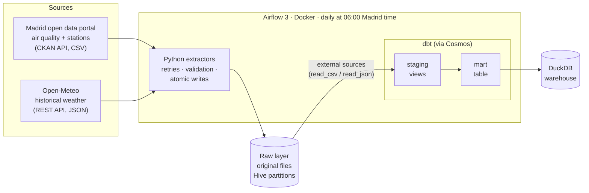
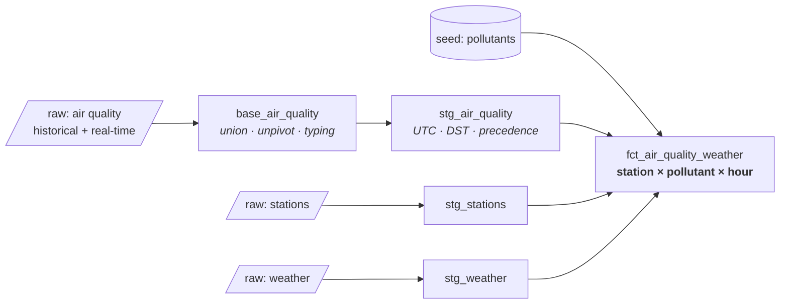

# Madrid Air Quality Pipeline

[](https://github.com/danielazo2002/madrid-air-quality-pipeline/actions/workflows/ci.yml)


**How does weather affect air pollution in Madrid?**

An end-to-end ELT pipeline that collects hourly air quality measurements from Madrid's 24 monitoring stations and hourly weather for the same locations, models them with dbt into an analysis-ready table, and runs every day on Airflow.

- **~3 million hourly measurements** since January 2024, refreshed daily
- **Extract** from two public APIs, with retries, validation and idempotent incremental loads
- **Transform** with dbt on DuckDB: unpivoting, time zone and daylight saving time handling, source precedence
- **Orchestrate** with Airflow 3 in Docker, one Airflow task per dbt model (Astronomer Cosmos)
- **Test** at every layer: 47 Python tests, 20 dbt data tests, 5 dbt unit tests, all in CI
- **31 documented design decisions**, with the alternatives considered: [DECISIONS.md](DECISIONS.md)

## Architecture



**ELT, not ETL.** Source files are stored untouched in a raw layer partitioned by period, download date, station and year. All transformation happens in dbt, so any model can be rebuilt from the raw files without downloading again.

### Data model



`fct_air_quality_weather` has one row per station, pollutant and hour (UTC), with the pollutant concentration, its unit and the weather at the same station and hour: temperature, humidity, precipitation, wind speed and direction, solar radiation and boundary layer height.

## Engineering highlights

The interesting parts of this project are the problems the data did not announce. Each one is covered by a test.

| Problem | Solution |
|---|---|
| Air quality files are **wide**: 24 hourly value/flag column pairs per row | `UNPIVOT` generated with a Jinja loop into one row per hour |
| Hours are in **Madrid local time**, so March has a missing hour and October a repeated one | Converted to UTC from the period start; non-existent hours detected with a local → UTC → local round trip. Both DST days are pinned by dbt unit tests |
| Hours not yet measured are published as **`0` with flag `N`** | Only flag `V` is valid (per the official documentation); everything else becomes NULL, never 0 |
| An **undocumented flag `M`** appeared in 3 rows | Caught by an `accepted_values` test; known flags listed, unknown ones raise a warning |
| Pollutant code `431` was being **truncated to `43`** (a different pollutant) by `lpad` | Fixed and guarded by a relationship test against the pollutant catalogue |
| The historical file is updated **monthly** and the real-time file only covers **today**: 30 days of October were missing | Switched to a 30-day accumulated feed; overlapping downloads resolved by validity, then source, then recency |
| The 30-day feed comes from a **paginated API** | The extractor requests one large page and fails if the page is full (possible truncation) or stations are missing |
| The data portal **reorganised its resources** during development | Download URLs are discovered at runtime from CKAN metadata, and missing years fail loudly |
| **DuckDB allows a single writer**, while Cosmos runs one process per dbt model | dbt tasks share an Airflow pool with one slot |

## First results

Correlation of hourly NO₂ concentration with weather, all stations, January 2024 to October 2026:

| Weather variable | Correlation with NO₂ |
|---|---|
| Wind speed | −0.38 |
| Boundary layer height | −0.37 |
| Temperature | −0.26 |

More wind and a deeper mixing layer disperse pollution, as expected physically. These are simple correlations: temperature and boundary layer height also follow the time of day and the season, so a proper analysis needs to control for both.

## Tech stack

| Layer | Tool | Why |
|---|---|---|
| Language and packaging | Python 3.12, [uv](https://docs.astral.sh/uv/) | Fast, reproducible environments with a lock file |
| Storage | [DuckDB](https://duckdb.org/) | Analytical database in a single file: clone and run, no cloud account |
| Transformation | [dbt Core](https://docs.getdbt.com/) 1.12 + dbt-duckdb | SQL models, tests and documentation as code |
| Orchestration | [Apache Airflow](https://airflow.apache.org/) 3.3 + [Cosmos](https://github.com/astronomer/astronomer-cosmos) | Industry standard; Cosmos shows each dbt model as an Airflow task |
| Containers | Docker Compose | Reduced setup with LocalExecutor (5 containers instead of 8) |
| Quality | pytest, dbt tests, [ruff](https://docs.astral.sh/ruff/), GitHub Actions | Every layer tested on every push |

## Running it

### Requirements

- [uv](https://docs.astral.sh/uv/getting-started/installation/)
- Docker with Docker Compose v2 (only for Airflow)
- Linux, macOS or WSL2 on Windows

### Local development

```bash
git clone https://github.com/danielazo2002/madrid-air-quality-pipeline.git
cd madrid-air-quality-pipeline
uv sync                        # Python 3.12, dependencies, dbt

# Extract into data/raw (the first run downloads ~2 years of data)
uv run python -m madrid_air_quality_pipeline.extract.stations
uv run python -m madrid_air_quality_pipeline.extract.air_quality
uv run python -m madrid_air_quality_pipeline.extract.weather

# Transform and test
cd dbt
mkdir -p ../data/warehouse
uv run dbt deps
uv run dbt build
uv run dbt show --select fct_air_quality_weather
```

### With Airflow

```bash
cat > .env <<EOF
AIRFLOW_UID=$(id -u)
FERNET_KEY=$(openssl rand -base64 32 | tr '+/' '-_')
AIRFLOW__API_AUTH__JWT_SECRET=$(openssl rand -hex 32)
EOF

docker compose build
docker compose up airflow-init
docker compose up -d
```

Open http://localhost:8080 (user `airflow`, password `airflow`), unpause the `madrid_air_quality` DAG and trigger it. Data is shared with local development through `data/`.

### Tests

```bash
uv run ruff check . && uv run ruff format --check .
uv run pytest

# dbt on the committed fixture dataset (the same check as CI)
cd dbt
export DATA_DIR="$PWD/../tests/fixtures/data"
mkdir -p "$DATA_DIR/warehouse"
uv run dbt build
```

## Project structure

```
├── src/madrid_air_quality_pipeline/
│   ├── config.py               # Paths, URLs, start year (overridable by environment)
│   ├── downloader.py           # HTTP with retries, header validation, atomic writes
│   └── extract/                # Stations, air quality (CKAN discovery), weather
├── dbt/
│   ├── models/staging/         # base + stg models, sources, data and unit tests
│   ├── models/marts/           # fct_air_quality_weather
│   └── seeds/pollutants.csv    # Pollutant codes, names and units
├── airflow/dags/               # Daily DAG
├── tests/                      # pytest suite and fixture dataset for CI
├── Dockerfile                  # Airflow image with dbt in an isolated virtualenv
├── docker-compose.yaml         # Postgres, scheduler, DAG processor, API server
└── DECISIONS.md                # 31 design decisions and their trade-offs
```

## Data sources

- **Air quality and stations**: [Madrid City Council open data portal](https://datos.madrid.es/), hourly data since 2001 and real-time data. Values are hourly averages; only data flagged `V` is valid according to the official file documentation.
- **Weather**: [Open-Meteo historical weather API](https://open-meteo.com/en/docs/historical-weather-api), hourly reanalysis data for the grid cell nearest to each station.

## Limitations and next steps

- **Single machine.** DuckDB and LocalExecutor keep the project cheap and reproducible. Moving to a cloud warehouse (BigQuery, Snowflake) would mainly change the dbt profile and the Cosmos concurrency setting.
- **Weather is modelled data** for a grid cell, not measured at the station. Recent days may still be revised.
- **Air quality is up to one day old**, matching the daily schedule.
- **Next:** a public dashboard on top of the fact table, and analysis controlling for season and time of day.

## License

[MIT](LICENSE)
